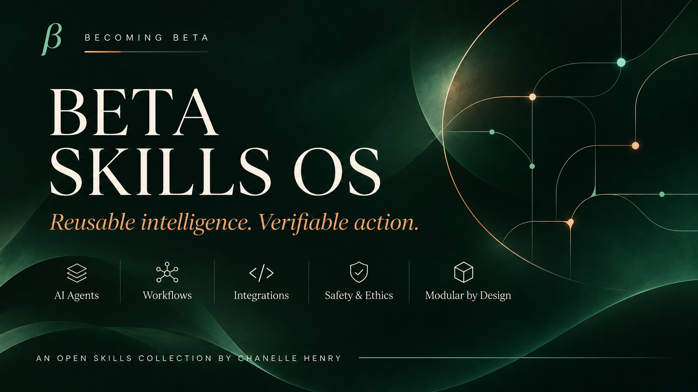

# Beta Skills OS



**Reusable intelligence. Verifiable action.**

A public, evolving collection of reusable AI-agent workflows developed from Chanelle Henry’s work across UX, AI, systems design, research, and accountability.

> **Release status:** v0.1.0 starter collection. These are structured skill drafts, not claims of production-tested automations or universal cross-platform compatibility.

## Skills

| Skill | Purpose | Provenance |
|---|---|---|
| [`brain-to-skill`](skills/brain-to-skill/SKILL.md) | Convert repeated problem-solving patterns into reusable, reviewable skills. | Chanelle-originated workflow concept |
| [`ssot-guardian`](skills/ssot-guardian/SKILL.md) | Reconcile project state and contradictions across agents and conversations. | Chanelle-originated workflow concept |
| [`chanelle-voice`](skills/chanelle-voice/SKILL.md) | Preserve Chanelle Henry’s editorial voice and brand intent. | Chanelle-originated workflow concept |
| [`verify-gate`](skills/verify-gate/SKILL.md) | Require inspectable evidence before consequential claims or external actions. | Chanelle-originated workflow concept |
| [`usage-observatory`](skills/usage-observatory/SKILL.md) | Track AI tool usage, limits, handoffs, and cost without fabricating telemetry. | Chanelle-originated workflow concept |
| [`deep-research`](skills/deep-research/SKILL.md) | Run structured, skeptical research with traceable sources. | Adaptation / review required |
| [`ux-copy`](skills/ux-copy/SKILL.md) | Adapt UX writing review principles with clear third-party attribution. | Adaptation / review required |
| [`publish-pipeline`](skills/publish-pipeline/SKILL.md) | Move approved ideas through drafting, editorial QA, and channel-specific publishing. | Chanelle-originated workflow concept |
| [`design-director`](skills/design-director/SKILL.md) | Direct visual work through a coherent design system and measurable QA. | Chanelle-originated workflow concept |
| [`agent-authority-audit`](skills/agent-authority-audit/SKILL.md) | Audit intended, configured, and observed authority of AI agents. | Chanelle-originated workflow concept |

## Philosophy

**Evidence over assertion. Execution over ceremony. Continuity over repetition.**

The skills are human-readable instructions, not executable software. Integrations, scheduled monitoring, and autonomous actions require a separate authorized runtime.

## Use

Read the relevant `skills/<name>/SKILL.md`, supply the inputs, and follow the procedure. Validate behavior in the target agent platform before treating it as installed.

## Repository layout

```text
assets/             Visual identity
docs/               Attribution, architecture, roadmap
examples/           Fictional, privacy-safe demonstrations
skills/<slug>/SKILL.md  Individual reusable skill definitions
```

## Attribution and licensing

See [provenance](docs/PROVENANCE.md). External skills are **not** copied into this repository. Source frameworks require review before adaptation or redistribution. No license is asserted for external work.

## Maintainer

Chanelle Henry · [chanellehenry.com](https://chanellehenry.com) · [becomingbeta.com](https://becomingbeta.com)
